# Portfolio

A personal investment ledger. You write down what happened (a deposit, some interest, a fee, a
withdrawal) and Portfolio works out your balance, earnings, returns and charts across all your
platforms and holdings.

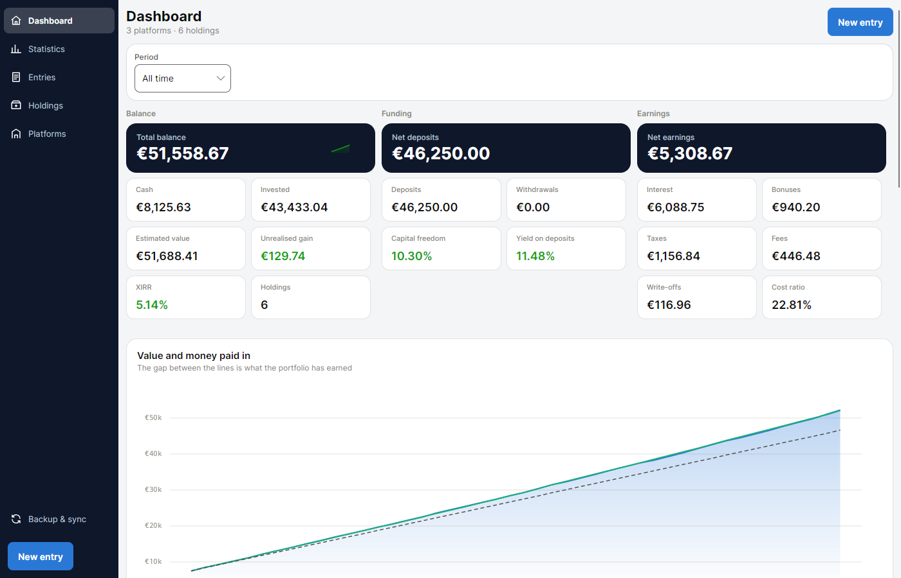

> [!NOTE]
> **About this README.** This guide was written by AI (Claude).
> **I have only tested the app on Windows and Android.** It also builds for macOS, Linux, iOS and
> the browser, but I have not tried those, so expect rough edges there.

## Features

- **Dashboard** with your total balance, deposits, earnings, return (XIRR) and charts over time.
- **Statistics for anything**: the whole portfolio, a single platform, a single holding, or every
  holding of one type, for any period.
- **Entries, holdings and platforms lists** with search, filters, sorting, grouping, and a
  cards or table view.
- **Live preview** when adding an entry: you see how your balance, invested capital and earnings
  will change before you save, plus warnings for common mistakes.
- **Works on desktop and phone** with a layout that adapts to the screen size.
- **Backup & sync** between devices with a single file. No account, no server, no cloud.
- **Your data stays on your device.**

## Getting started

You need the [.NET 10 SDK](https://dotnet.microsoft.com/download). Then, from this folder:

### Windows

```bash
dotnet run --project Portfolio.Desktop
```

### Android

Install the Android workload once:

```bash
dotnet workload install android
```

Connect your phone with USB debugging enabled (Android 7.0 or newer), then:

```bash
dotnet build Portfolio.Android -t:Install
```

### Try it in the browser

```bash
dotnet run --project Portfolio.Browser
```

The browser version starts with **demo data** so you can look around without entering anything.
All the screenshots in this guide come from it.

## How it works

Your portfolio is organised in three levels:

| Level | What it is | Example |
|---|---|---|
| **Platform** | Where your money is: a broker, bank or lending site | Trade Republic, Mintos |
| **Holding** | A specific investment on that platform | "Dividend stocks", "Cash savings" |
| **Entry** | Something that happened to a holding on a date | Deposited €300, earned €12 interest |

So the first time you open the app:

1. **Add a platform** from the *Platforms* screen.
2. **Add a holding** to it from the *Holdings* screen, and pick its role (see below).
3. **Add entries** with the **New entry** button, which is always visible.

Everything else (balances, earnings, returns, charts) is calculated from your entries.

### Holding roles

Each holding has a *role* that describes what you are doing with it. It is used for grouping and
filtering, so pick whatever fits best:

| Role | Meaning |
|---|---|
| Grow | You keep adding money to it |
| Compound | Its income is reinvested |
| Hold | Left alone, no money in or out |
| Buffer | A cash reserve |
| Shrink | Slowly winding it down |
| Exit | Closing it out |
| Other | Anything else |

## Adding an entry

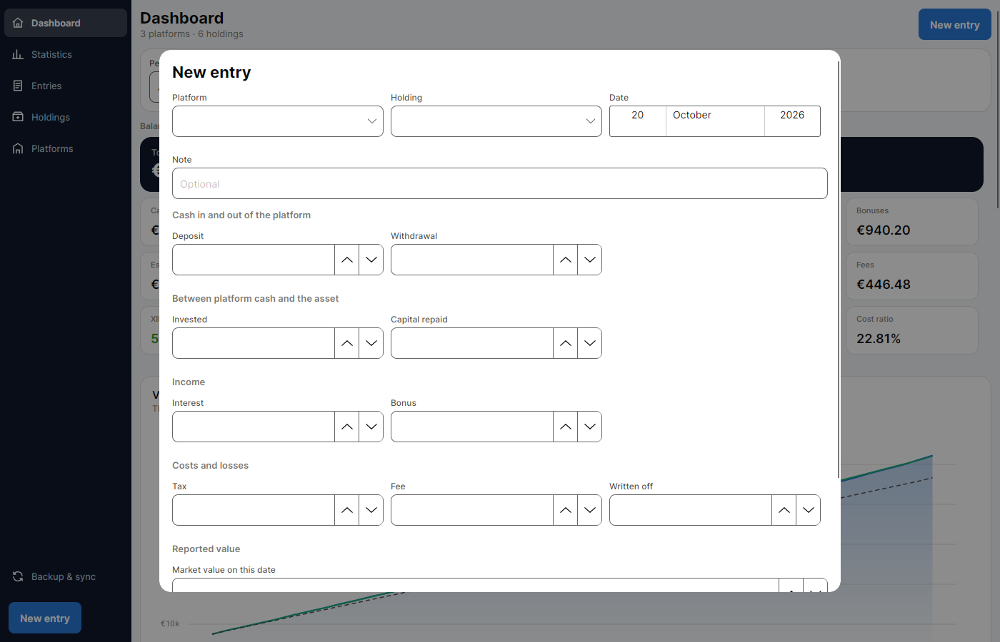

Pick the platform, the holding and the date, then fill in only the fields that apply. One entry
can contain several things at once, such as a deposit that you invested the same day, or interest
with tax taken off.

| Section | Fields | Use it when… |
|---|---|---|
| Cash in and out of the platform | Deposit, Withdrawal | You send money to the platform or take it out |
| Between platform cash and the asset | Invested, Capital repaid | Cash on the platform goes into the investment, or comes back from it |
| Income | Interest, Bonus | You earn interest, dividends, rewards or referral bonuses |
| Costs and losses | Tax, Fee, Written off | You pay tax or fees, or lose money because an investment defaulted |
| Reported value | Market value on this date | The platform tells you what the holding is worth today |

All amounts are entered as positive numbers. The section they go in decides whether money is
coming in or going out.

At the bottom of the form you can see how the entry changes your balance, invested capital and
earnings. You will also get a warning if something looks wrong, such as a date in the future or
withdrawing more cash than you have.

> [!TIP]
> **Market value** is optional. Fill it in only when your platform reports a value (for example a
> fund's current price). It is used as the holding's estimated value until you enter a new one.

## The screens

### Dashboard

Your whole portfolio at a glance: balance, money paid in, earnings, return and charts. Use the
**Period** selector to look at a single month, a year, or all time.

### Statistics

The same figures and charts, for whatever you choose in **Scope**: the whole portfolio, one
platform, one holding, or a group of holdings. You can also open it straight from any holding or
platform with the **Stats** button.

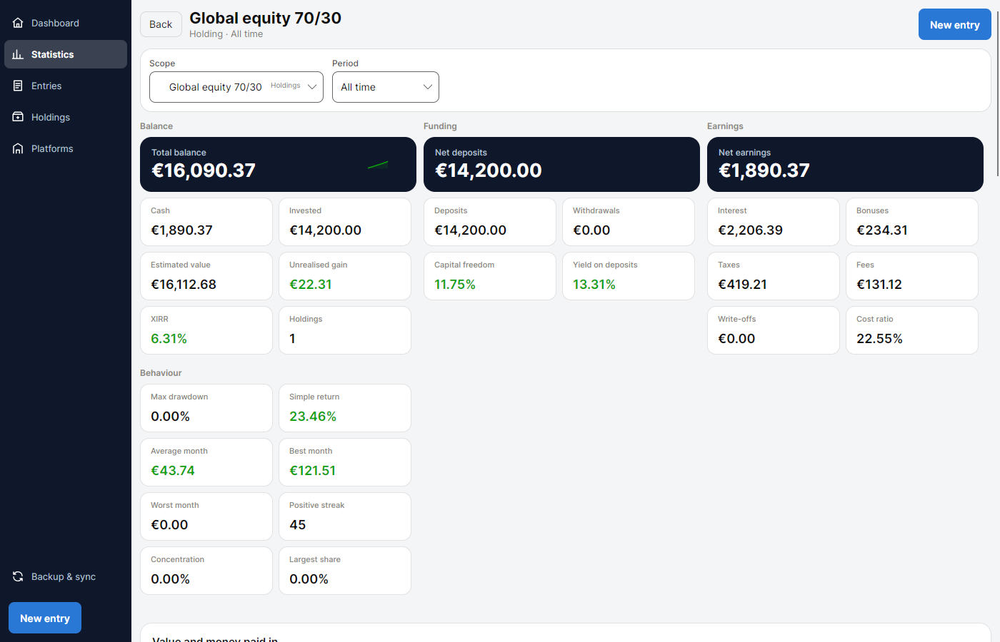

### Entries

Every entry you have recorded. Search by note, holding or platform, filter by period, platform,
holding or type of movement, and sort or group the results. The bar above the list shows the
totals for whatever is currently filtered.

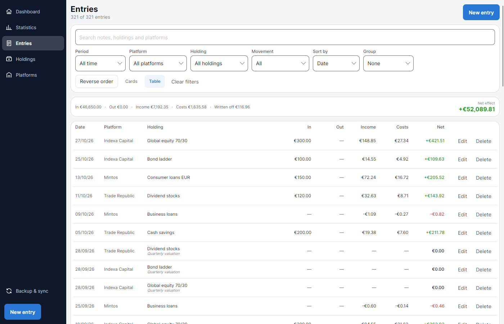

### Holdings

All your holdings with balance, invested, earnings, return and share of the portfolio. Group them
by platform or role, and switch between **Cards** and **Table**.

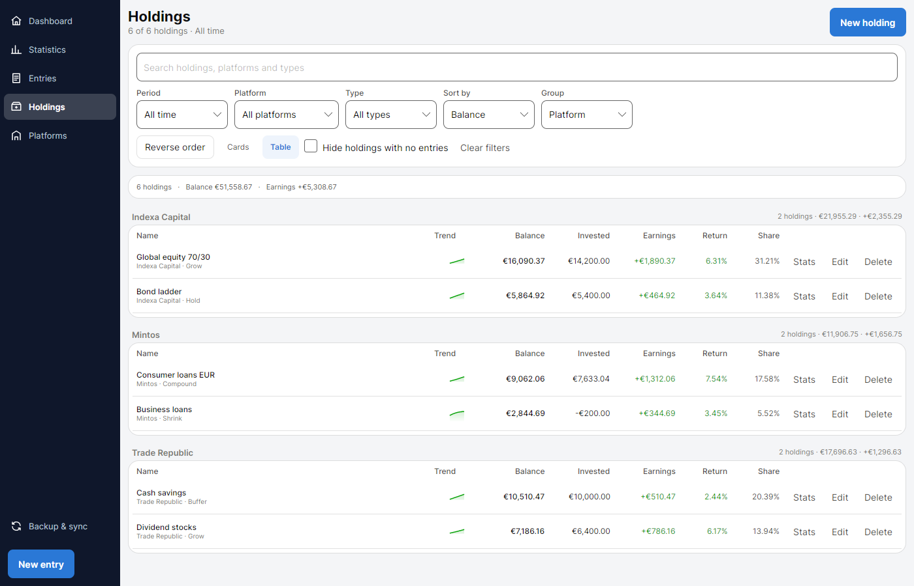

### Platforms

Your platforms and how your money is split between them.

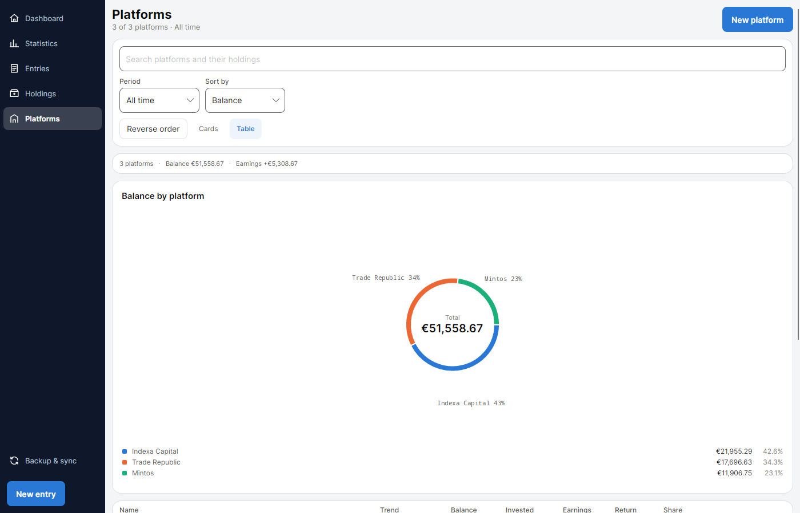

### On a phone

On a narrow screen the side menu becomes a bottom bar, lists default to cards, and editors open as
full pages so the back gesture works as expected. The backup screen is behind the sync icon on the
dashboard.

<table>
  <tr>
    <td>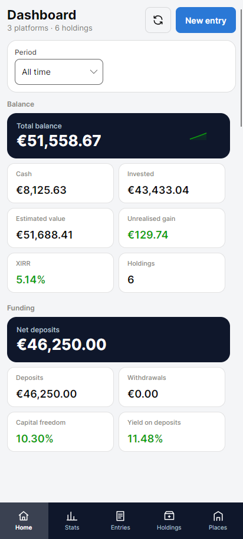</td>
    <td>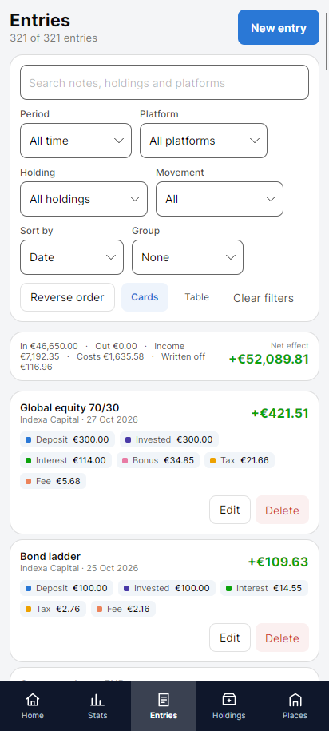</td>
    <td>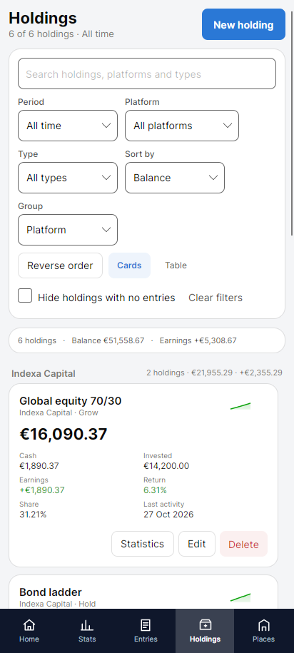</td>
    <td>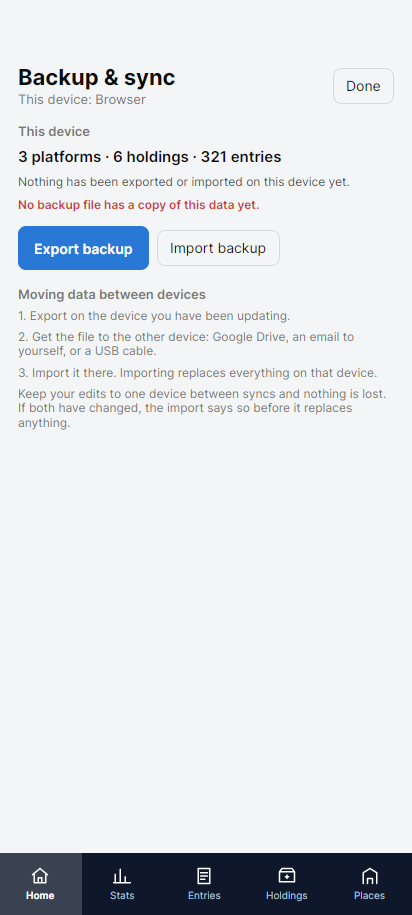</td>
  </tr>
</table>

## Backup & sync between devices

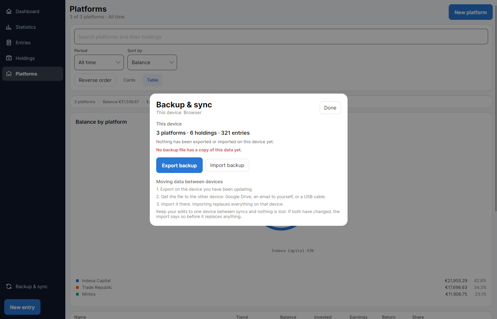

Portfolio has no cloud account. To move your data from one device to another (for example from
your PC to your phone):

1. On the device with the latest data, open **Backup & sync** and press **Export backup**. This
   saves a file such as `portfolio-2026-10-06-desktop.json`.
2. Move the file to the other device any way you like: Google Drive, email, a USB cable…
3. On the other device, open **Backup & sync**, press **Import backup** and pick the file.

> [!WARNING]
> **Importing replaces everything on that device.** Nothing is merged. If the device has changes
> that are not in the file, the app tells you before it replaces anything.

Before every import the app keeps a **restore point** of the data it replaced. If you imported by
mistake, press **Restore** on the same screen to get it back.

The easiest routine is to make your changes on one device only, and export/import whenever you
want the other one to catch up.

> [!CAUTION]
> Backup files contain all your financial data. Keep them somewhere private.

## Where your data is stored

| Device | Location |
|---|---|
| Windows | `%LOCALAPPDATA%\Portfolio\Portfolio.db` |
| Android | Inside the app's private storage (removed if you uninstall the app, so export a backup first) |
| Browser | The browser's local storage for that site |

## For developers

Project structure, architecture and build notes are in [TECHNICAL.md](TECHNICAL.md).

## License

[MIT](LICENSE.txt)
